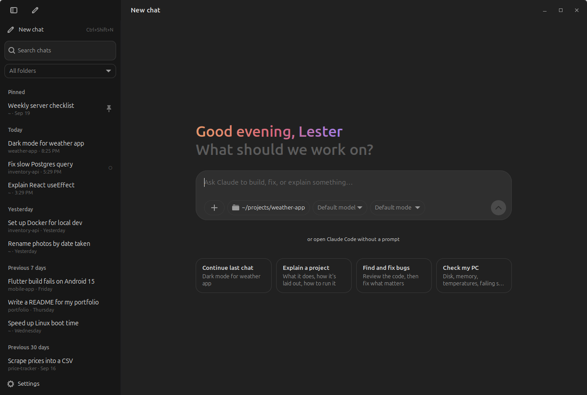
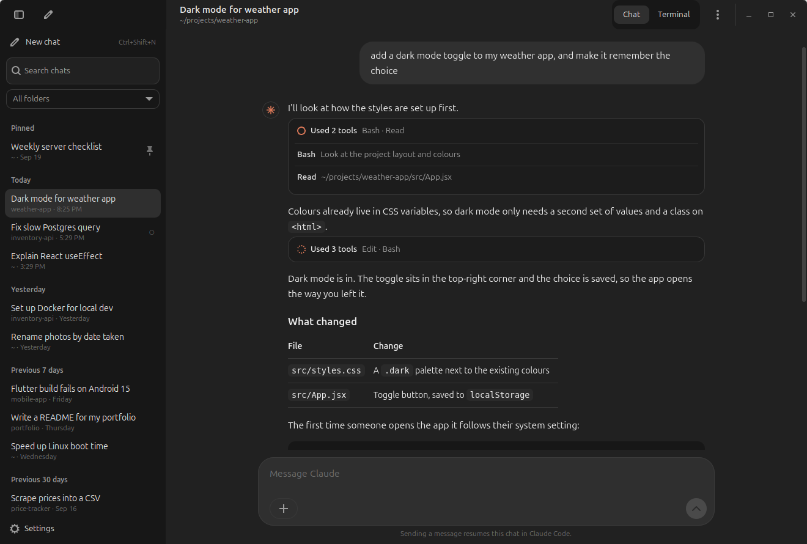

# Claude Terminal

> **Unofficial.** Not made by, affiliated with, or endorsed by Anthropic.
> "Claude" and "Claude Code" are Anthropic's names. This app doesn't replace
> Claude Code; it runs the official `claude` command you already have.

A ChatGPT/Gemini-style desktop window for Claude Code on Linux. Every Claude
Code conversation on the machine is listed in a sidebar. Click one to read it
as chat bubbles, then type a reply to resume it, with the real Claude Code
running in an embedded terminal in the folder the chat started in.

Anthropic's own desktop app is Mac and Windows only, so this fills that gap on
Linux. It was built and tested on a ThinkPad T495 running Linux Mint 22.3
(Cinnamon, X11) with Claude Code 2.1.283.





*Screenshots use made-up demo chats.*

Contents: [1 Features](#1-features) · [2 Install](#2-install-update-uninstall) ·
[3 Using it](#3-using-it) · [4 How it works](#4-how-it-works) ·
[5 Keys](#5-keyboard-shortcuts) · [6 Files](#6-files) · [7 Tests](#7-tests) ·
[8 Limits](#8-known-limits) · [9 License](#9-license-and-author)

---

## 1. Features

* **Sidebar of every chat**: terminal and VS Code chats together, titled with
  Claude Code's own AI titles and grouped Today / Yesterday / Previous 7 days /
  Previous 30 days / by month. Pinned chats stay on top.
* **Search** across titles, folders and everything you typed, plus a folder
  filter to narrow the list to one project.
* **Chat view**: messages as bubbles with Markdown, tables and highlighted
  code (with Copy buttons). Tool calls fold into cards that open to show the
  command and its output. It updates live while Claude is working.
* **Terminal view**: the real Claude Code in a VTE terminal, so permission
  prompts, slash commands, `/model` and everything else work as usual.
* **One-click resume** in the right folder. Replying from the chat view
  resumes the chat, or types straight into it if Claude is already running.
* **Status dots**: green means running here, a pulsing orange dot means
  Claude is working, and a hollow dot means it's open in VS Code or another
  terminal.
* **Safe with other windows**: a chat that's already open elsewhere is opened
  as a copy (`--fork-session`) unless you choose otherwise, so two processes
  never write the same history.
* **Home page**: a greeting, a prompt box, and pickers for folder, model and
  permission mode, plus suggestion cards and "Continue last chat".
* Desktop notification when Claude finishes in a chat you aren't looking at;
  drag and drop files to insert their paths; pin, rename, fork and delete
  (to the Trash) from the right-click menu.

## 2. Install, update, uninstall

| Needs | Why |
| --- | --- |
| Claude Code (`claude` on your `PATH` or in `~/.local/bin`) | The app runs it |
| `python3-gi`, `gir1.2-gtk-3.0` | Window and widgets |
| `gir1.2-vte-2.91` | Embedded terminal |
| `gir1.2-webkit2-4.1` | Chat view |
| `gir1.2-handy-1` | Centred, width-limited layout |
| `python3-markdown`, `python3-pygments` | Formatting messages and code |

```sh
sudo apt install python3-gi gir1.2-gtk-3.0 gir1.2-vte-2.91 gir1.2-webkit2-4.1 \
                 gir1.2-handy-1 python3-markdown python3-pygments
git clone https://github.com/lestorrr/claude-terminal.git
cd claude-terminal
./install.sh
```

`install.sh` needs no root. It adds **Claude Terminal** to the app menu and
the desktop (marked trusted, so Nemo doesn't warn about the launcher), links
a `claude-terminal` command into `~/.local/bin`, and installs the icon. The app
runs from the cloned folder, so updating is `git pull`.

`./uninstall.sh` removes the launchers, icon and command. Add `--purge` to also
remove the app's settings and cache. Your Claude Code chats are never touched.

## 3. Using it

* **New chat** (Ctrl+Shift+N): type what you want, pick the folder, model and
  permission mode, press Enter. *Open Claude Code without a prompt* starts an
  empty session instead. In a folder Claude Code hasn't seen before, it first
  asks whether you trust it; that prompt defaults to **No**, so press ↓ first.
* **Click a chat** to read it. Press **Terminal** (or Ctrl+Shift+T), or just
  send a message, to continue it. If Claude is already running for that chat,
  the message goes straight into it.
* **Right-click a chat** (or use the ⋮ menu): continue, pin, rename, open a
  copy, start a new chat in the same folder, open the folder, copy the session
  ID, stop Claude, delete.
* When Claude exits, a bar offers **Resume** or **Close**. Closing the window
  stops the Claude processes inside it, asking first if one is mid-task; the
  chats themselves are always saved.
* **Settings**: your name for the greeting, terminal font, and whether to list
  chats started in VS Code or headless `claude -p` runs.

## 4. How it works

```
 ~/.claude/projects/<folder>/<id>.jsonl ──read──▶ sessions.py ──▶ sidebar (cached index)
 ~/.claude/sessions/<pid>.json          ──read──▶  (who's live)    └──▶ render.py ──▶ chat view (WebKit)
                                                        │
 app.py ── spawns, in the chat's own folder ──▶ VTE terminal
            claude --resume <id> [message]                 (continue a chat)
            claude --resume <id> --fork-session            (open a copy)
            claude --session-id <new id> [prompt]          (new chat with a known id)
```

| Path | Access | What it holds |
| --- | --- | --- |
| `~/.claude/projects/*/*.jsonl` | read only | One append-only file per chat, written by Claude Code |
| `~/.claude/sessions/<pid>.json` | read only | Running Claude processes: session ID, busy/idle, VS Code or CLI |
| `~/.config/claude-terminal/config.json` | read/write | Pins, renames, last folder, model/mode, font, filters |
| `~/.cache/claude-terminal/index.json` | read/write | Sidebar index, so start-up doesn't re-read every chat |

Details worth knowing:

* **Indexing** only JSON-parses lines that can matter (titles, typed prompts,
  the working folder) and remembers each file's read offset, so a refresh
  reads just what was appended. About 60 chats and 700 MB of history index in
  under a second the first time, and in milliseconds after that.
* **Transcripts** follow the `parentUuid` chain back from the newest message,
  so rewound branches (Esc Esc) are hidden, and compaction boundaries link
  back through `logicalParentUuid` so the history before `/compact` still
  shows.
* **Resume has to run in the chat's original folder**, because that's where
  Claude Code looks for it. If the folder is gone, the app says so instead of
  failing.
* **Live status** comes from `~/.claude/sessions`, with each pid checked
  against `/proc/<pid>/stat` start time so a reused pid isn't mistaken for
  Claude. A terminal that runs `/clear` or `/resume` is followed to its new
  session ID.
* VTE merges the environment it's given into the app's own, so variables a
  parent Claude session sets (`CLAUDECODE`, `CLAUDE_CODE_*`) are removed from
  the app's environment at start-up. Otherwise a Claude started from inside
  another one would stop saving its transcript.
* Renames and pins live in the app's config, not in Claude's files, so they
  only show up here.

## 5. Keyboard shortcuts

| Keys | Action |
| --- | --- |
| Ctrl+Shift+N | New chat |
| Ctrl+Shift+F | Search chats |
| Ctrl+Shift+S | Show or hide the sidebar |
| Ctrl+Shift+T | Switch between chat and terminal |
| Ctrl+Shift+W | Stop Claude in this chat |
| Ctrl+Shift+C / V | Copy / paste in the terminal |
| Ctrl+scroll | Zoom the terminal |
| Ctrl+click | Open a link in the terminal |
| Enter / Shift+Enter | Send / new line in the message box |

Everything uses Ctrl+Shift so plain Ctrl keys still reach Claude Code.

## 6. Files

| File | What it is |
| --- | --- |
| `app.py` | GTK 3 window: sidebar, home page, chat view, terminals, menus, dialogs |
| `sessions.py` | Chat index, transcript parser, running-session detection (no GTK) |
| `render.py` | Transcript → HTML for the chat view |
| `chat.css` | Look of the chat view |
| `style.css` | Look of the GTK parts |
| `icon.svg` | App icon |
| `install.sh`, `uninstall.sh` | Per-user launchers, icon and command |
| `tests/test_sessions.py` | Offline tests |

## 7. Tests

```sh
python3 -m unittest discover -s tests
```

32 tests, no display or GTK needed. They cover message classification
(prompts, slash commands, notifications, images), incremental and cached
indexing including half-written lines and rewritten files, branch and
compaction handling, live-process detection, and HTML escaping and Markdown
quirks in the renderer.

## 8. Known limits

* Tested on Linux Mint 22.3 with Cinnamon on X11. It's plain GTK 3, so other
  desktops and Wayland should work but haven't been tried.
* It reads Claude Code's on-disk format, which isn't a public API. A Claude
  Code update could change it; this was built against 2.1.283.
* Claude Code's permission prompts appear only in the Terminal view, which is
  why sending a message switches to it.
* A chat can only be resumed while the folder it started in still exists.
* Renames and pins don't show in Claude Code's own `/resume` list.

## 9. License and author

MIT, see [LICENSE](LICENSE). © 2026 John Lester Liclican ·
[@lestorrr](https://github.com/lestorrr) · [jhnlstrlclcn.engineer](https://jhnlstrlclcn.engineer/)
